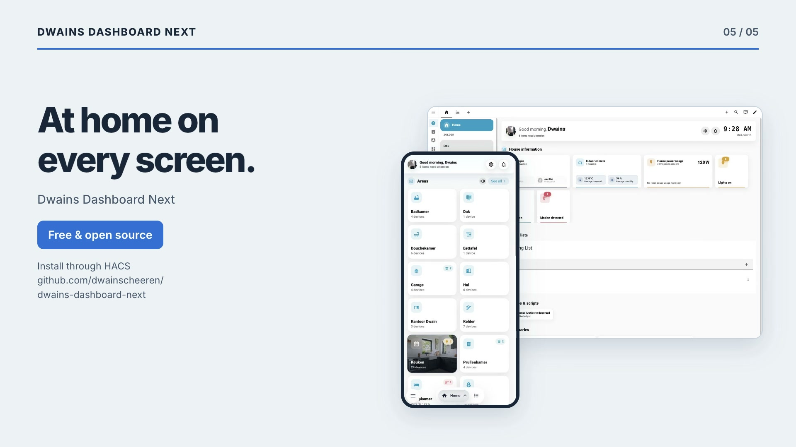
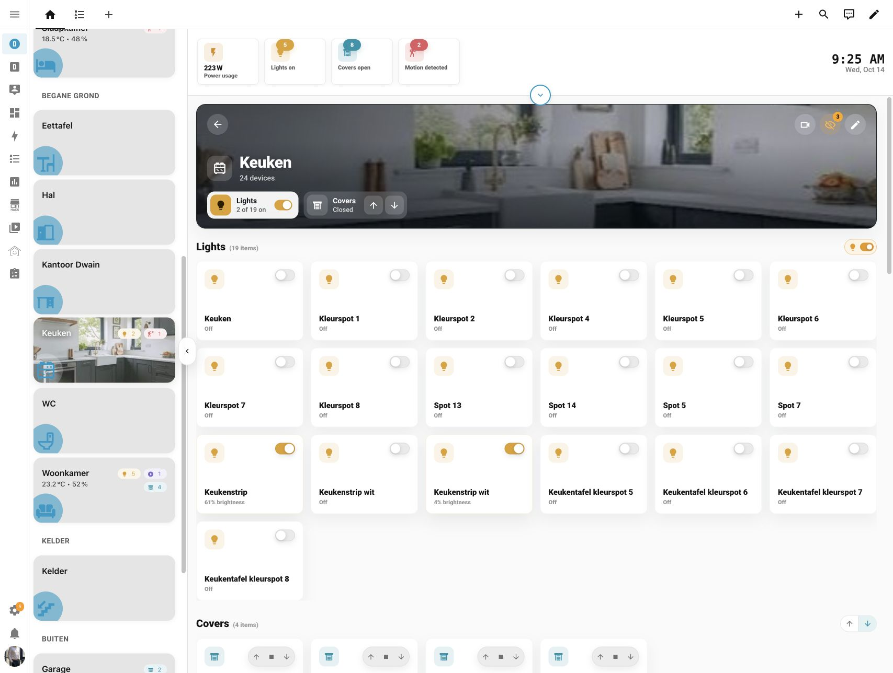

<p align="center">
  
</p>

# Dwains Dashboard Next

Dwains Dashboard Next is the next generation of Dwains Dashboard for Home Assistant.

It installs as a Home Assistant dashboard through HACS. On a normal HACS setup it does not require a custom integration, Python files, YAML setup, or manual file uploads.

See this as Dwains Dashboard v4: totally rebuilt from scratch, with a completely new design and new features.

<p align="center">
  <a href="https://my.home-assistant.io/redirect/hacs_repository/?owner=dwainscheeren&repository=dwains-dashboard-next&category=dashboard">
    
  </a>
</p>

## Preview

[](https://dwainscheeren.github.io/dwains-dashboard-next/media/dd-next-1.11-home-areas.mp4)

[Watch the launch video](https://dwainscheeren.github.io/dwains-dashboard-next/media/dd-next-1.11-home-areas.mp4) · 22 seconds · 1080p · Music

Current screenshots from **v1.11.0**, captured in October 2026. The interface is in English; room and entity names come from the Home Assistant setup.

<p align="center">
  
</p>

<p align="center">
  
</p>

<p align="center">
  
  
</p>

See the [screenshot gallery](docs/screenshots.md) for room controls, wall tablet settings and more views. Camera previews are hidden in the current captures.

## Documentation

- [Documentation website](https://dwainscheeren.github.io/dwains-dashboard-next/)
- [Documentation home](docs/index.md)
- [Installation](docs/installation.md)
- [Getting started](docs/getting-started.md)
- [Navigation](docs/navigation.md)
- [Dashboard settings](docs/dashboard-settings.md)
- [Home page](docs/home-page.md)
- [Areas](docs/areas.md)
- [Devices](docs/devices.md)
- [Blueprints](docs/blueprints.md)
- [Custom cards](docs/custom-cards.md)
- [User permissions](docs/user-permissions.md)
- [Screenshots](docs/screenshots.md)

## Status

Current release: `1.12.0`

## Community And Support

- Chat and feedback: [Dwains Dashboard Discord](https://discord.gg/7yt64uX)
- Support development: [Buy Me a Coffee](https://www.buymeacoffee.com/FAkYvrx)
- Support development: [PayPal](https://www.paypal.me/dwainscheeren)

## Requirements

- Home Assistant 2026.5.0 or newer
- HACS

## Installation

Use the HACS button above or follow the full [installation guide](docs/installation.md).

## HACS Resource Troubleshooting

HACS normally adds the Dwains Dashboard Next JavaScript resource automatically. If your Home Assistant setup uses YAML-managed Lovelace resources, HACS cannot update those resources automatically. In that case the dashboard file is installed, but `Dwains Dashboard Next` will not appear in the Add dashboard dialog until you add the resource yourself.

Add this to the existing `lovelace:` section in `configuration.yaml`:

```yaml
lovelace:
  resources:
    - url: /hacsfiles/dwains-dashboard-next/dwains-dashboard-next.js
      type: module
```

Do not create a second `lovelace:` section if one already exists. Merge the `resources:` entry into the existing one, then restart Home Assistant or reload Lovelace resources and hard-refresh the browser.

## What It Does

- Creates an automatic dashboard based on Home Assistant areas, devices, entities and floors.
- Registers itself in the native Add dashboard dialog.
- Runs fully in the frontend as a JavaScript dashboard resource.
- Does not require installing a Home Assistant integration.

## Development

```bash
npm install
npm run type-check
npm run build
```

The production dashboard file is generated at:

```text
dist/dwains-dashboard-next.js
```

Editors, dialogs and languages are split into separate files in `dist/chunks/` and are only loaded when needed. When testing a build in your own Home Assistant, copy the whole `dist/` folder, not only the main file.

### Tests

Unit tests use [Vitest](https://vitest.dev) and live in `tests/`:

```bash
npm test            # run all tests once
npm run test:watch  # re-run tests on every change
```

CI runs `npm run type-check`, `npm run i18n:check`, `npm test` and `npm run build` on every push and pull request.

### Screenshots

Automated desktop and mobile screenshots can be generated against a running Home Assistant instance:

```bash
npm run screenshots:install
DD_SCREENSHOT_USERNAME=your-user DD_SCREENSHOT_PASSWORD=your-password npm run screenshots
```

Useful options:

```bash
DD_SCREENSHOT_BASE_URL=http://localhost:8123
DD_SCREENSHOT_DASHBOARD_PATH=/dd-next
DD_SCREENSHOT_AREA_ID=living_room
DD_SCREENSHOT_OUTPUT_DIR=screenshots/generated
DD_SCREENSHOT_THEMES=light,dark
DD_SCREENSHOT_FULL_PAGE=true
DD_SCREENSHOT_COLLAPSE_HA_SIDEBAR=false
DD_SCREENSHOT_PRIVACY_CAMERAS=false
DD_SCREENSHOT_PRIVACY_CAMERA_DIR=assets/demo-cameras
```

If `DD_SCREENSHOT_DASHBOARD_PATH` is not set, the script tries to find the Dwains Dashboard Next dashboard automatically. Screenshots are written by theme, viewport and page, for example `screenshots/generated/light/desktop/home.png`. By default the script captures home, devices, dashboard settings and a few settings detail pages. The Home Assistant sidebar is collapsed by default for desktop screenshots; set `DD_SCREENSHOT_COLLAPSE_HA_SIDEBAR=false` to keep it open. Camera feeds are replaced with demo images by default so private camera views do not end up in screenshots. Set `DD_SCREENSHOT_PRIVACY_CAMERAS=false` only when you explicitly want real camera images.

### Dashboard Video

An automated dashboard tour video can be recorded against the same running Home Assistant instance:

```bash
npm run video:install
DD_VIDEO_USERNAME=your-user DD_VIDEO_PASSWORD=your-password npm run video
```

By default this records a mobile light-mode walkthrough and saves it as `videos/generated/light/mobile-tour.webm`. Set `DD_VIDEO_THEMES=light,dark` to create a separate video for each theme.

Useful options:

```bash
DD_VIDEO_BASE_URL=http://localhost:8123
DD_VIDEO_DASHBOARD_PATH=/dd-next
DD_VIDEO_AREA_ID=living_room
DD_VIDEO_OUTPUT_DIR=videos/generated
DD_VIDEO_VIEWPORTS=mobile,desktop
DD_VIDEO_THEMES=light,dark
DD_VIDEO_TRIM_START_SECONDS=6
DD_VIDEO_COLLAPSE_HA_SIDEBAR=false
DD_VIDEO_PRIVACY_CAMERAS=false
DD_VIDEO_PRIVACY_CAMERA_DIR=assets/demo-cameras
```

The video tour opens the home page, scrolls down and back up, opens an area, scrolls the area, opens and closes an entity dialog, opens the devices page, opens a device group and then opens dashboard settings. The first 6 seconds are trimmed by default to remove login/loading time; set `DD_VIDEO_TRIM_START_SECONDS=0` to keep the full recording. Desktop recordings collapse the Home Assistant sidebar by default. Camera feeds are replaced with demo images by default; set `DD_VIDEO_PRIVACY_CAMERAS=false` only when recording a private/local video where real camera images are wanted.

## HACS

This repository is structured as a HACS Dashboard plugin.

The dashboard file is:

```text
dist/dwains-dashboard-next.js
```

HACS downloads everything under `dist/`, including the `dist/chunks/` folder that the dashboard file loads on demand.

## License

Dwains Dashboard Next is released under the MIT License.

See [LICENSE](LICENSE) for the full license terms.
