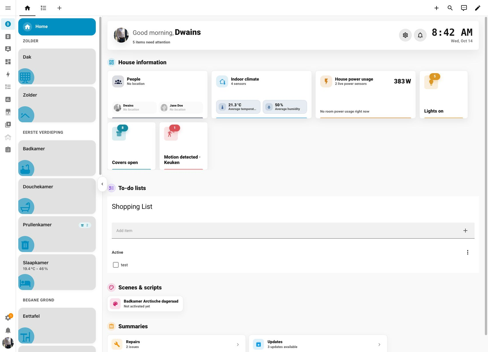
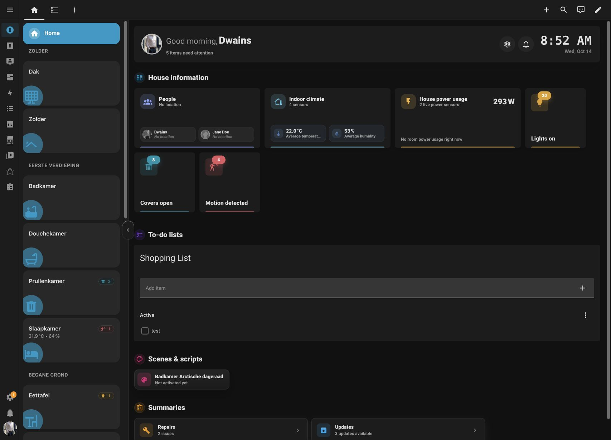
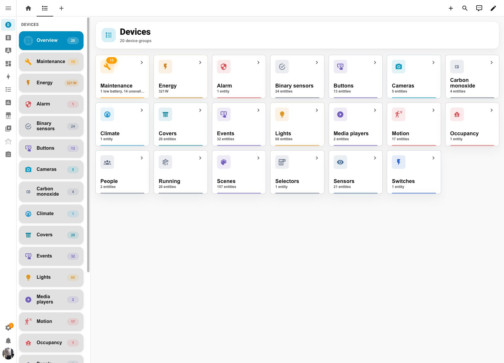
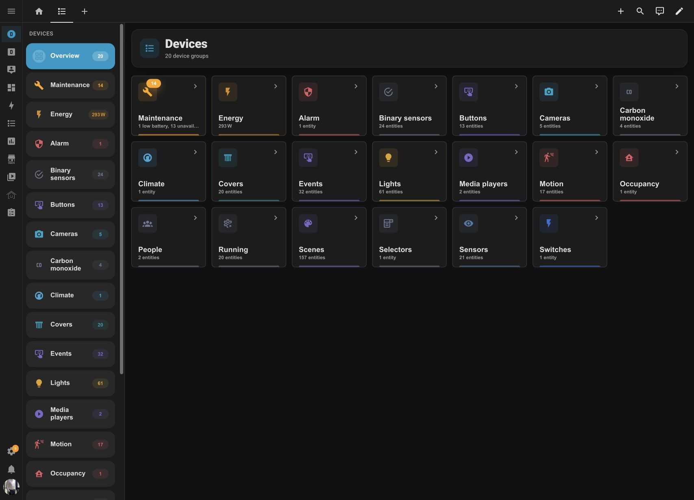
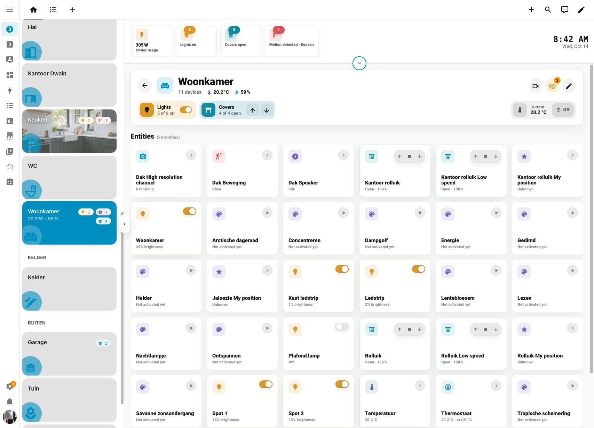
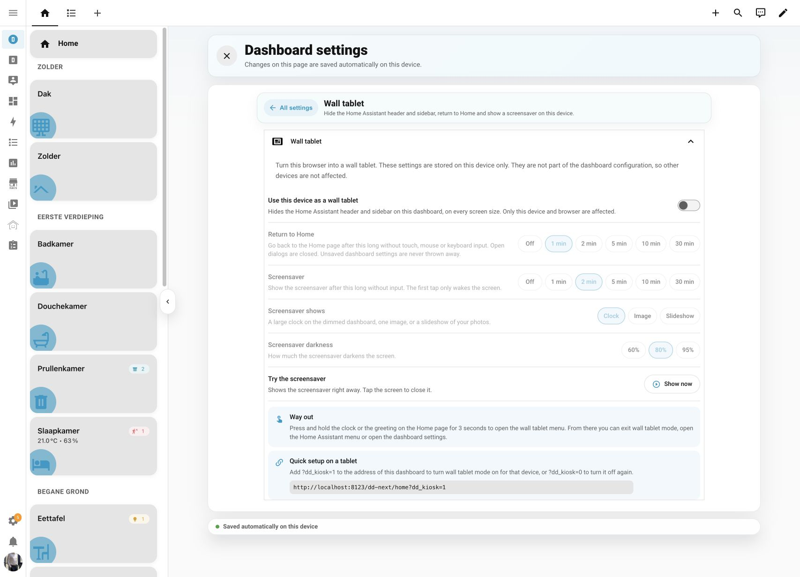
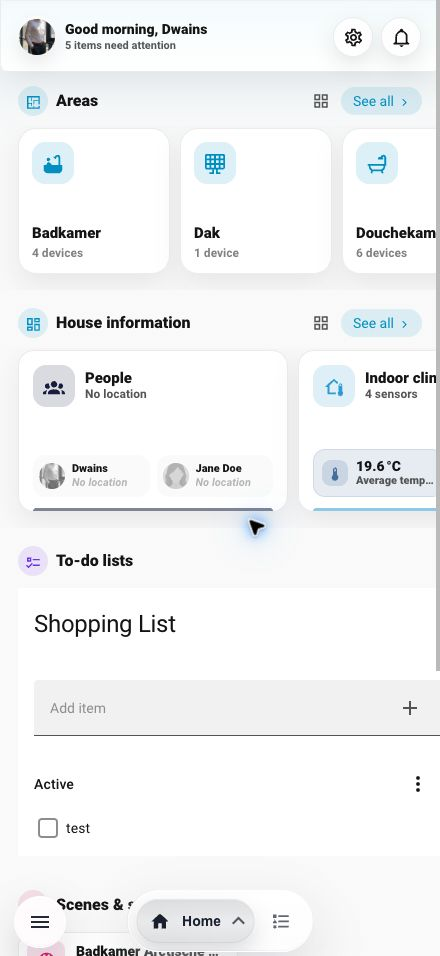
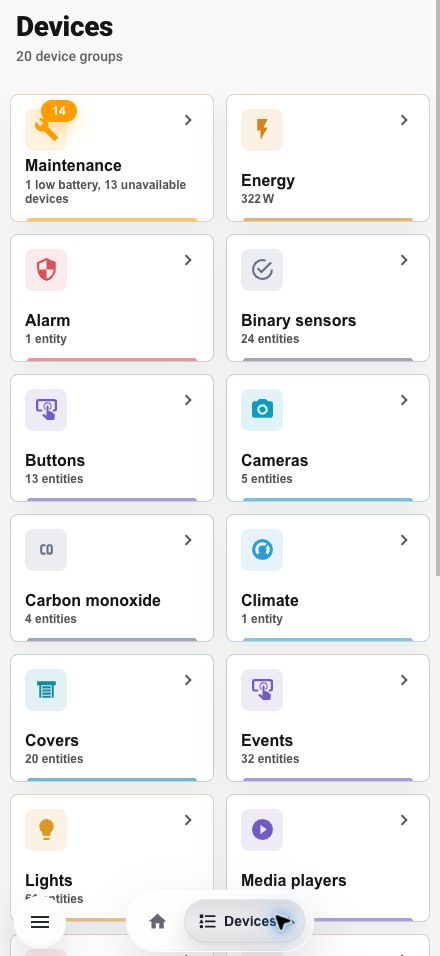
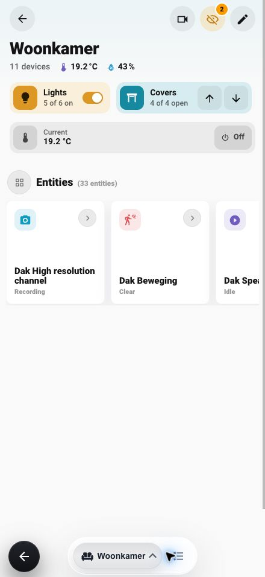

# Screenshots

## Current gallery — v1.11.0

Captured from Dwains Dashboard Next v1.11.0 in Chrome on October 14, 2026. The interface is in English; room and entity names reflect the example Home Assistant setup. Camera previews are hidden in these captures.

### Home and devices

| Light mode | Dark mode |
| --- | --- |
|  |  |
|  |  |

### Room controls

### Wall tablet settings

### Mobile

  
  
  

## Earlier screenshots

These captures document an earlier version of Next. Camera previews in this older set use the demo images from `assets/demo-cameras`.

### Desktop

| Light mode | Dark mode |
| --- | --- |
|  |  |
|  |  |
|  |  |

### Mobile

| Light mode | Dark mode |
| --- | --- |
|  |  |
|  |  |
|  |  |

### Area Page

| Light mode | Dark mode |
| --- | --- |
|  |  |
|  |  |

### Settings Details

| Page | Desktop | Mobile |
| --- | --- | --- |
| Home page |  |  |
| Devices page |  |  |
| Areas |  |  |
