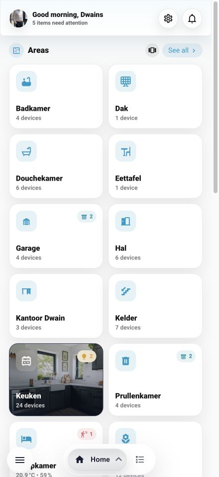
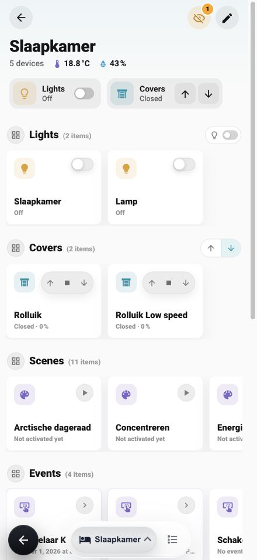

# Screenshots

## Launch video

<video controls preload="metadata" poster="media/dd-next-1.11-home-areas.jpg" style="max-width:100%;height:auto;">
  <source src="media/dd-next-1.11-home-areas.mp4" type="video/mp4">
  <a href="media/dd-next-1.11-home-areas.mp4">Watch the DD Next launch video</a>
</video>

[Download the 22-second video](media/dd-next-1.11-home-areas.mp4). It uses the current gallery images and original instrumental music.

## Current gallery — v1.11.0

Captured from Dwains Dashboard Next v1.11.0 in Chrome on October 14, 2026. The interface is in English; room and entity names reflect the example Home Assistant setup. Camera previews are hidden in these captures.

### Home

| Light mode | Dark mode |
| --- | --- |
|  |  |

### Home and areas on mobile

  
  

### Individual room controls

  
  

### Also available: devices by type

| Light mode | Dark mode |
| --- | --- |
|  |  |

### Wall tablet settings

